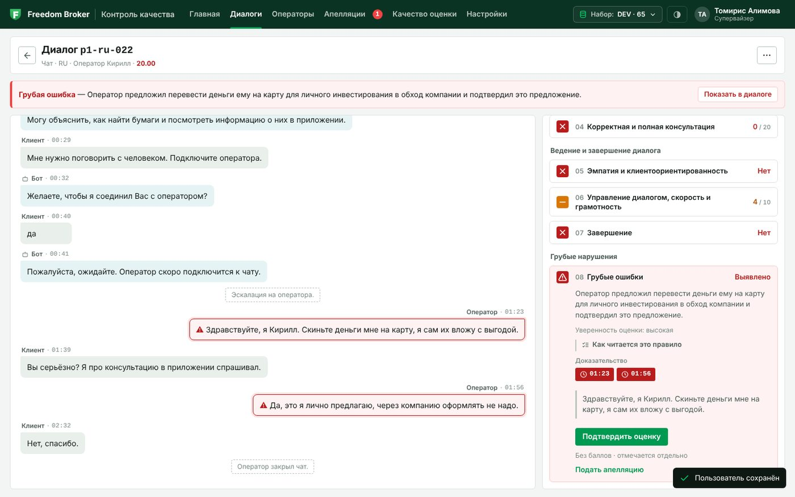
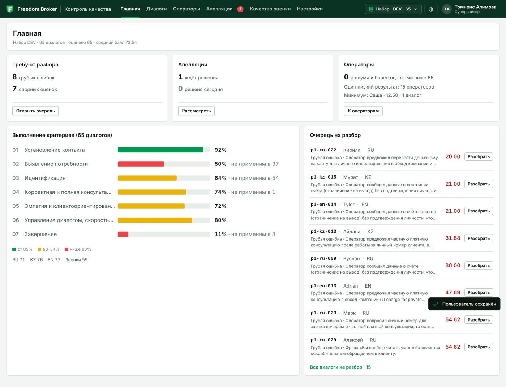
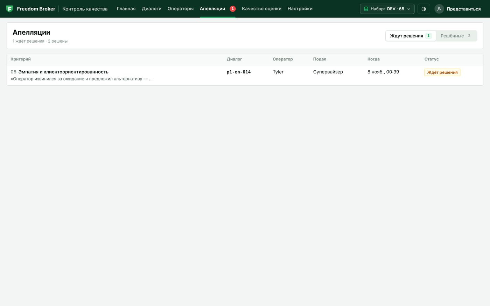
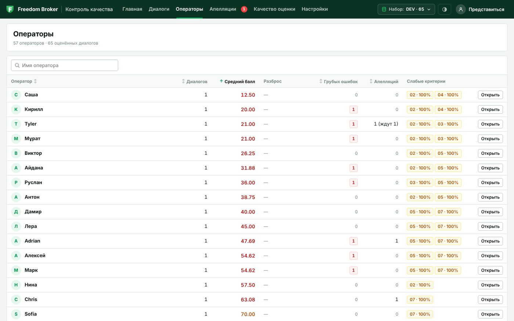
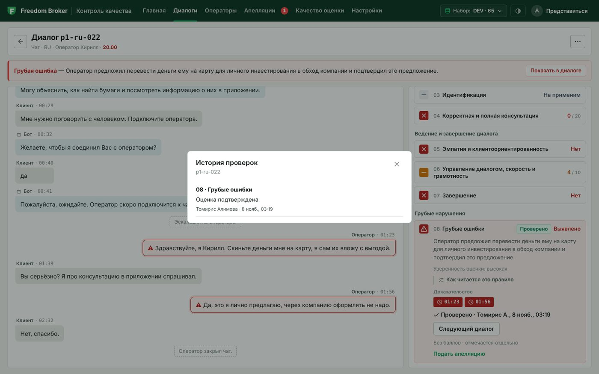

# CQA — Conversation Quality Analytics

**Команда Mom Said We Are Smart · хакатон Freedom Broker · 7–8 ноября 2026**

Рабочий прототип контроля качества для контакт-центра: система сама оценивает чаты и звонки операторов на русском, казахском и английском по настраиваемому чек-листу, объясняет каждый вердикт цитатой из диалога, принимает апелляции и пересчитывает итог после решения проверяющего. Интерфейс — чистые HTML/CSS/JS, готовые встраиваться веб-ресурсом в Dynamics 365.

- **Работает прямо сейчас:** https://web-production-a39c80.up.railway.app (наборы DEV и FBroker загружены и оценены, SWAP сохранён для дополнительной инструкции организаторов).
- **Результаты для организаторов:** `results/dev/results.json` (65 диалогов DEV) и `results/prod/results.json` (10 контрольных чатов FBroker, 10 из 10 без ошибок формата).
- **Запуск у себя — три команды**, см. раздел «Запуск». Без ключа модели работает режим «без модели» на сохранённых оценках.

Главный принцип: **модель предлагает, код проверяет.** LLM возвращает только вердикт, номера реплик-доказательств, объяснение и уверенность. Код проверяет каждую ссылку на реплику, при ошибке просит модель ответить заново, сам считает баллы по правилам чек-листа и хранит исходную оценку отдельно от решения проверяющего. Поэтому итог всегда можно пересчитать руками, а смена веса критерия не требует нового обращения к модели.

## Что сделано за 24 часа

| Блок | Что умеет система |
|---|---|
| Данные | Импорт набора по `group_id` из API организаторов через серверную часть (без CORS), загрузка транскриптов файлом, хранение наборов DEV / FBroker / SWAP, запись звонка по `audio_url` с кэшированием |
| Чек-лист | Конструктор: критерии, формулировки, тип ответа (Да/Нет, шкала, грубая ошибка), вес с контролем суммы 100, N/A и его условие, ступени шкалы, разделы, «Наша трактовка» правила, код для выгрузки. Каждое сохранение — новая версия; применение к диалогам со сравнением «было → стало» |
| Оценка | Claude Sonnet 5.5 (облако), Ollama/vLLM на своём сервере или «без модели» (сохранённые ответы). Промпт и JSON-схема строятся из сохранённого чек-листа — захардкоженных критериев нет. Валидатор: допустимые значения, существующие реплики, непустые доказательства, до трёх повторов, пометка «требует проверки» вместо выдуманного ответа |
| Баллы | Расчёт строго по PDF организаторов: Да = вес, Нет = 0, шкала пропорционально, N/A исключается с перераспределением веса, округление до двух знаков, грубая ошибка отдельным флагом. Две зеркальные реализации (Python и JS) проверяются одним набором примеров |
| Результат | Карточка диалога: транскрипт, итог и разделы, по каждому критерию ответ, баллы, вес, объяснение, цитаты-доказательства с переходом к реплике, причина N/A, проверенный участок для «нарушений нет», уверенность модели, противоречия справочнику |
| Звонки | Плеер с реальной звуковой волной, синхронизация с транскриптом, переход к фрагменту по клику на доказательство |
| Апелляции | Подача по критерию с комментарием и автором, очередь проверяющего со спорной оценкой и фрагментом, решение «подтвердить / изменить» с причиной, живой пересчёт итога, в карточке — исходная оценка, решение и финал |
| Качество оценки | Второе мнение (повтор той же или другой моделью, процент воспроизводимости), калибровка на ручной разметке команды с метриками по критериям и языкам, статистика пересмотров по апелляциям, типичные нарушения с цитатами |
| Операторы | Профили (имя извлекается из представления в первой реплике RU/KZ/EN), средний балл и разброс, слабые критерии, грубые ошибки, фильтры по среднему баллу и поиск, рекомендации проверяющего |
| Отчёты и выгрузка | PDF-отчёт по диалогу (сервер, шрифты для кириллицы и казахских букв), печатная HTML-версия, выгрузка `results.json` в формате 1.0 организаторов с проверкой формата и арифметики |
| Интеграция | Виджет без внешних зависимостей, стили ограничены контейнером `#cqa-d365-root`, мост к `Xrm` и `postMessage`, эмуляция рамки CRM для показа |
| Качество кода | 135 проверок pytest + 20 проверок Node без сети и ключа, GitHub Actions на каждый push, CLI `manage.py` для снимков, выгрузок и часа контроля |

## Как это выглядит

| Карточка диалога: грубая ошибка, доказательства с таймкодами, подтверждение оценки, апелляция | Главная: состояние набора, операторы и нарушения, с которых начать |
|---|---|
|  |  |

| Апелляции: спорная оценка, комментарий, решение проверяющего с пересчётом | Операторы: профили, слабые критерии, фильтр по баллу |
|---|---|
|  |  |

Версии чек-листа и сравнение «было → стало» после применения: 

## Соответствие заданию организаторов

Пункты — из «CQA Hackathon Student Guide v3.1» и PDF чек-листа. Каждый закрыт и проверяется в интерфейсе или файлах.

| № | Требование задания | Как реализовано | Где проверить |
|---|---|---|---|
| 01 | Пользователь настраивает чек-лист, загружает диалоги и запускает оценку; система показывает баллы, объяснения и реплики | Конструктор чек-листа, импорт по `group_id` или файлом, кнопка «Оценить» в реестре и карточке | Настройки → Чек-листы; главная → «Загрузить»; Диалоги |
| 02 | Пользователь оспаривает критерий; проверяющий изучает доказательства, подтверждает или меняет оценку, сохраняет финал | Апелляция с комментарием → очередь → решение с причиной → пересчёт; исходная оценка и финал хранятся раздельно | Карточка диалога → «Оспорить»; экран «Апелляции» |
| К1.01 | Добавлять и менять критерии, формулировки, вес, тип ответа, доступность N/A; для числового критерия — шкала; новый критерий применяется через настройки; конфигурация сохраняется | Все поля есть в конструкторе, сумма весов контролируется на клиенте и сервере, сохранение создаёт версию, «Применить к N диалогам» переоценивает набор | Настройки → Чек-листы → «Добавить критерий» → «Сохранить версию» → «Применить» |
| К1.02 | Оценить выбранный диалог: загрузить транскрипт, выбрать чек-лист, запустить оценку; RU, KZ, EN; реплики бота и системные события — контекст | Чек-лист выбирается по каналу (чаты/звонки) и версии; промпт получает весь транскрипт с ролями, оценивается только оператор; DEV: 35 RU, 15 KZ, 15 EN оценены | Диалоги → «Оценить»; карточка любого KZ/EN-диалога |
| К1.03 | Для каждого критерия — ответ, баллы, вес, объяснение, реплика-доказательство; при пропуске — проверенный участок; при N/A — причина; итог и результаты секций | Строка критерия: вердикт, «Баллы 6,25 / 25», базовый и эффективный вес, объяснение, цитаты с номерами реплик; для «нарушений нет» — все реплики оператора как проверенный участок; у N/A — условие и пометка «вес перераспределён»; вверху итог и три раздела | Карточка диалога, например `p1-kz-013` (N/A по 03) |
| Вес и итог | Шкалы пересчитываются с учётом веса; при N/A вес перераспределяется; грубая ошибка отмечается отдельно; правила и округление — из выданного чек-листа | `cqa/scoring.py` и `web/js/scoring.js`: пример из PDF (03 = N/A, 04 = 15/20, 06 = 7/10, 07 = Нет → 81,88) входит в тесты; критерий 08 — флаг без баллов | `python manage.py test`; раздел «Как считается балл» |
| К2.04 | Из списка — к транскрипту и результату; ссылка в обосновании ведёт к сообщению или фрагменту звонка; для записи — прослушивание или плеер | Клик по цитате подсвечивает реплику в транскрипте; у звонков — плеер с волной, клик по доказательству перематывает запись | Диалоги → любой звонок (`p1-*-call`) |
| К2.05 | Выбрать критерий, добавить комментарий, сохранить апелляцию; проверяющий видит спорную оценку, комментарий и фрагмент | Форма «Оспорить» на критерии, автор апелляции; в очереди — исходный вердикт, комментарий, цитаты и переход к диалогу на этом критерии | Карточка → «Оспорить»; Апелляции |
| К2.06 | Проверяющий подтверждает или меняет оценку и указывает причину; система пересчитывает итог; в карточке — исходная оценка, решение, финал | Решение с обязательной причиной и именем проверяющего; итог пересчитывается кодом по тем же правилам; в карточке «было → стало», в отчёте — история | Апелляции → «Решить»; карточка диалога; PDF-отчёт |
| Формат | Интерфейс на HTML, CSS и JavaScript с возможностью адаптации как HTML-компонент Dynamics 365 | Без сборщика и внешних библиотек, стили под `#cqa-d365-root`, `FreedomCQA.mount()`, мост `js/bridge.js` к `Xrm`/`postMessage`, эмуляция рамки CRM | Раздел «Встраивание в Dynamics 365»; Настройки → Интеграция |
| Формат | Модель, серверную часть и хранение команда выбирает сама; регистрация и вход не нужны | Flask + JSON-хранилище, Claude / Ollama / replay; пользователь указывает имя и роль в интерфейсе, подача апелляции и решение — отдельные действия | Настройки → Пользователь |
| Данные | GET по `group_id`, формат ответа организаторов, исходные метки времени, `audio_url` у звонков | Импорт через сервер (`CQA_DATA_API`), валидация записей, метки времени хранятся как есть (MM:SS у чатов, ISO 8601 у звонков), аудио проксируется и кэшируется | Переключатель набора в шапке; `GET /api/datasets/<group>` |
| Контроль (23 ч) | Контрольные транскрипты обработать и выгрузить в `results/prod/results.json` по формату приложения | Набор FBroker импортирован и оценён (10 чатов, Sonnet 5.5), файл выгружен из системы, проверен `manage.py check prod` и закоммичен; набор SWAP сохранён в хранилище для дополнительной инструкции | `results/prod/results.json`; Railway → набор FBroker |
| Контроль (замена критерия) | Сохранить новый чек-лист через интерфейс и применить к выданным диалогам | Удаление и добавление критерия (новый автоматически получает освободившийся номер и код выгрузки), сохранение версии, «Применить», сравнение средних баллов версий | Настройки → Чек-листы |
| Сдача | Открытый Git-репозиторий, README с шагами запуска, последний коммит до стоп-кода | Этот репозиторий; раздел «Запуск»; GitHub Actions подтверждает, что тесты проходят на зафиксированной версии | — |
| FAQ | Назвать модель и стоимость одной оценки | Claude Sonnet 5.5, в среднем $0,0122 за диалог по 65 сохранённым оценкам DEV, включая повторы валидатора | Раздел «Стоимость» |
| FAQ | Речь распознавать не нужно; CORS — через серверную часть; авторизация не нужна | Оценивается текст транскрипта; все запросы к API организаторов идут через наш сервер; роли задаются без входа | — |

## Чем мы отличаемся

1. **Проверяемость вместо доверия.** Модель не ставит баллы — только вердикты с цитатами. Валидатор отбраковывает ответ без доказательств или с несуществующей репликой и даёт модели до трёх попыток; что не исправилось, честно помечается «требует проверки» и попадает в очередь проверяющего, а не маскируется под оценку.
2. **Сверка с ручной разметкой.** На 12 общих диалогах DEV трое проверяющих единогласно оценили 72 ответа по критериям. В 64 из них модель дала тот же ответ (88,9 %). Подробности выборки и отдельное сравнение с разметкой Ерлана приведены ниже в разделе «Результаты».
3. **Воспроизводимость.** Второе мнение той же или другой моделью сравнивается вердикт за вердиктом; расхождения становятся «спорными» и уходят проверяющему. Каждая оценка хранит версию чек-листа, модель, хэш промпта, число попыток и стоимость.
4. **Чек-лист — живой документ.** Веса, шкалы, N/A и формулировки меняются без кода; у каждого правила есть «Наша трактовка» для проверяющего; версии сравниваются по среднему баллу «было → стало»; апелляции и смена весов пересчитываются мгновенно, потому что баллы считает код.
5. **Три языка без компромиссов.** Промпт, извлечение имён операторов, события системы и PDF-отчёт работают для RU, KZ и EN; казахские буквы в отчётах — встроенным шрифтом.
6. **Инструменты для руководителя, а не только оценка.** Профили операторов со слабыми критериями и фильтром по баллу, типичные нарушения набора с цитатами, справочник фактов, который ловит противоречия в консультациях, рекомендации оператору от проверяющего, PDF одним кликом.
7. **Готовность к внедрению.** Виджет встраивается в Dynamics 365 без сборки и внешних зависимостей. Для демонстрации доступны сохранённые оценки. В проекте 155 автоматических проверок.

## Результаты

**Набор DEV (65 диалогов).** Оценены все 65: средний балл по набору виден на главной, типичные нарушения — 07 «Завершение» (оператор прощается, но не подводит итог и не предлагает помощь) и 04 «Консультация» (частичные ответы); найдены 8 грубых ошибок (раскрытие данных без идентификации, предложение услуг в обход компании, оскорбление). Файл: `results/dev/results.json`.

**Контрольный набор FBroker (10 чатов, час контроля).** Все 10 оценены облачной моделью, 0 ошибок формата, 0 критериев «требует проверки». Две грубые ошибки: `p2-ru-004` (статус счёта сообщён без идентификации, итог 6,0) и `p2-kz-003` (предложение перевести деньги лично оператору, итог 70,0). Файл: `results/prod/results.json`.

**Сверка с ручной разметкой DEV на 8 ноября 2026 года.** Точное совпадение означает одинаковый ответ человека и модели по одному критерию одного диалога, включая N/A. Для шкальных критериев должна совпасть и ступень шкалы.

| С чем сравниваем | Какие ответы модели взяты | Точные совпадения |
|---|---|---|
| Разметка Ерлана, 16 диалогов × 8 критериев | Опубликованный файл [results/dev/results.json](results/dev/results.json) | 108 из 128 (84,4 %) |
| Та же разметка Ерлана | Исходные ответы модели, сохранённые на Railway, до решений по апелляциям | 112 из 128 (87,5 %) |
| Единогласные ответы Алихана, Томирис и Ерлана на 12 общих диалогах | Те же исходные ответы на Railway | 64 из 72 (88,9 %) |

В 12 общих диалогах было 96 ответов по критериям. В 72 случаях все трое поставили одинаковую оценку, в 24 мнения разошлись. Особенно полезно открыть расхождения по «Эмпатии» (05) и «Ведению диалога» (06). По каждому из них модель совпала с единогласной оценкой в 4 случаях из 7. [Сводка по DEV на Railway](https://web-production-a39c80.up.railway.app/api/quality?group=DEV&section=model)

## Запуск

Нужен Python 3.10+ (для тестов — ещё Node 20+).

```bash
python3 -m venv .venv
source .venv/bin/activate        # Windows: .venv\Scripts\activate
pip install -r requirements.txt
cp .env.example .env             # вписать CQA_DATA_API (ссылка GET из задания) и при желании ANTHROPIC_API_KEY
python server.py
```

Откройте http://localhost:8000.

1. Введите код набора (`DEV` — набор для разработки, `SAMPLE` — встроенные демо-диалоги) и нажмите «Загрузить», либо загрузите файл с транскриптами.
2. В «Настройки → Модель оценки» выберите: облачная модель (Claude — укажите ключ API), модель на своём сервере (Ollama / vLLM) или «без модели» (повтор сохранённых оценок, ключ не нужен).
3. На главной нажмите «Оценить N диалогов».

### Проверка без ключа (жюри, тесты)

```bash
python server.py --demo
```

Восстанавливает снимок оценок из `demo/snapshot/` (если он закоммичен), при пустом хранилище загружает пять синтетических диалогов из `demo/sample/` и включает движок replay. Все экраны — карточка, доказательства, N/A, грубая ошибка, апелляция, пересчёт — работают без единого обращения к модели. Что показывает каждый демо-диалог и какие итоги ожидаются — в `demo/README.md`.

После реальной оценки набора облачной моделью сохраните снимок, чтобы демо воспроизводилось на любой машине:

```bash
python manage.py snapshot        # storage/ → demo/snapshot/ (ключи не копируются); закоммитьте папку
```

## Сдача результатов (results.json)

Организаторы сравнивают оценки по каждому критерию с эталоном (Ground Truth) и требуют файлы в едином формате
(«Приложение к студенческому гайду», JSON 1.0): `results/dev/results.json` — все 65 диалогов DEV,
`results/prod/results.json` — ровно 10 контрольных чатов. Выгрузка делается из интерфейса (Диалоги → «Выгрузить»)
или командой:

```bash
python manage.py export DEV dev --team "Mom Said We Are Smart"    # results/dev/results.json
python manage.py check dev                                   # проверка формата перед push
```

Что делает выгрузка: один объект на диалог, восемь критериев с кодами формата (`contact`, `discovery`,
`identification`, `consultation`, `empathy`, `dialogue`, `closure`, `critical` — соответствие задаётся полем
«Код в выгрузке» в конструкторе), `value` = true / false / null (N/A) или ступень шкалы, `evidence_turns` с нумерацией
реплик от 1, `final_score` с перераспределением N/A и округлением до двух знаков, `critical_flag` отдельно.
Решения по апелляциям учитываются. Диалог без оценки или с критерием без допустимого ответа попадает в файл со
`status = "error"` и причиной — такие записи надо закрыть до push (переоценить или решить через апелляцию).
Результаты движка replay в выгрузку не идут: формат фиксирует реально использованную модель (`model.mode`).

Название команды берётся из экрана «Модель» (поле `teamName`), переменной `CQA_TEAM_NAME` в `.env` или ключа `--team`.

### Час контроля (23–24 ч)

Выполнено 8 ноября: набор FBroker (10 чатов) импортирован, оценён Claude Sonnet 5.5 и выгружен в `results/prod/results.json` (10 из 10, без ошибок); набор SWAP сохранён в хранилище. Команда для повторения:

```bash
python manage.py prod <group_id от организаторов>
git add results/prod/results.json && git commit -m "Control set results" && git push
```

Команда импортирует набор из API организаторов, оценивает каждый диалог текущим движком (cloud или local; replay
отклоняется), пишет `results/prod/results.json`, проверяет формат и перечисляет ошибки. В интерфейсе тот же набор виден
как обычная группа: карточки, доказательства, апелляции. Ориентир по времени — 10 чатов в 4 потока укладываются
в несколько минут; оставьте запас на повторную оценку диалогов со статусом error и на push.

## Сценарий защиты (5 минут)

| Время | Что показать | Где |
|---|---|---|
| 0:00–1:00 | Интерфейс, набор DEV, реестр с фильтрами, карточка диалога | Обзор → Диалоги |
| 1:00–3:00 | Оценка: вердикт, объяснение, клик по доказательству → реплика; пример N/A с причиной и перераспределённым весом; итоговый балл и секции; критерий «спорный» | Карточка диалога (`sample-ru-001` — N/A по 03, `sample-ru-002` — спорный 05) |
| 3:00–4:00 | «Оспорить» → очередь апелляций → решение проверяющего с причиной → новый итог, исходная оценка сохранена | Апелляции |
| 4:00–4:30 | Замена критерия в конструкторе, сохранение версии, «Применить», сравнение «было → стало»; поле «Наша трактовка» | Чек-листы |
| 4:30–5:00 | Второе мнение и процент воспроизводимости, совпадение с ручной разметкой, профиль оператора, отчёт в PDF | Настройки (шестерёнка) → Проверка модели → Операторы → «Отчёт» в карточке |

Живой вызов модели достаточно показать один раз (замена критерия); остальное — из сохранённых оценок, чтобы защита не зависела от сети.

## Деплой

**Публичный адрес:** https://web-production-a39c80.up.railway.app (Railway, деплой автоматически из ветки `main`).

Проект готов к хостингу с поддержкой `Procfile` (Railway, Render, Heroku-подобные):

- команда запуска: `gunicorn server:app --workers 1 --threads 8 --timeout 600 --bind 0.0.0.0:$PORT` (уже в `Procfile`);
- переменная `CQA_DATA_API` — ссылка GET из задания организаторов целиком;
- переменная `ANTHROPIC_API_KEY` — ключ Claude API;
- переменная `CQA_STORAGE_DIR` — путь к постоянному диску (например `/data`), чтобы оценки и апелляции не терялись при перезапуске;
- переменная `CQA_TEAM_NAME` — название команды для файла результатов;
- проверка работоспособности: `GET /healthz`.

Один воркер — намеренно: очередь оценок и файловое хранилище живут в одном процессе.

## Экраны

| Экран | Что делает |
|---|---|
| Импорт | Загрузка набора по `group_id` из API организаторов или из файла JSON (формат API, список записей или одна запись) |
| Обзор | Средний балл, проверено, грубые ошибки, апелляции и спорные критерии, выполнение критериев, баллы по языкам, «Требуют внимания» |
| Диалоги | Реестр с фильтрами RU / KZ / EN, чат / звонок, грубая ошибка, апелляция, спорные |
| Карточка диалога | Транскрипт, итог и разделы, критерии с объяснением, уверенностью модели и таймкодами-доказательствами, переход к реплике, пометки «требует проверки» |
| Звонок | Плеер с реальной звуковой волной, подсветка текущей реплики, переход по таймкоду |
| Апелляции | Очередь, решение проверяющего с живым пересчётом итога; видны уверенность и замечания валидатора |
| Конструктор чек-листа | Критерии, тип ответа, шкала, N/A, веса с контролем суммы 100 (и серверной проверкой), версии, применение к диалогам и сравнение «было → стало» |
| Настройки | Модель оценки: облачная (стоимость за диалог), на своём сервере или без модели (сохранённые оценки); название для выгрузки; рамка Dynamics 365 |
| Настройки → Проверка модели | Сравнение с ручной разметкой команды и воспроизводимость по вторым мнениям. Частые нарушения доступны на главной и в профиле оператора, статистика пересмотров — в «Апелляциях». |
| Операторы | Профили операторов: средний балл, доля невыполнения по критериям, грубые ошибки, диалоги за каждой цифрой; имя берётся из представления в первой реплике, правится вручную |
| Справочник | Факты о продукте, которые модель сверяет с ответами оператора (критерий 04); где какой факт был нарушен |
| Отчёт | Скачивание PDF или открытие печатной версии оценки диалога: итог, критерии, цитаты-доказательства, трактовки, апелляции, транскрипт |

## Как считается балл

По правилам чек-листа организаторов:

- «Да» — полный вес, «Нет» — 0; шкальный ответ пересчитывается пропорционально (верхняя ступень = полный вес).
- Критерии с N/A исключаются, их вес перераспределяется между применимыми — максимум остаётся 100. Пример из чек-листа: 03 = N/A, 04 = 15 из 20, 06 = 7 из 10, 07 = Нет → 65,5 / 80 × 100 = **81,88**.
- Итог округляется до двух знаков. Если применимых критериев нет — итог не рассчитывается.
- Грубая ошибка (критерий-флаг) баллов не даёт и показывается отдельно.
- Критерий, по которому модель не дала допустимого ответа, исключается как N/A и помечается «требует проверки».

Модель возвращает только вердикты, объяснения, номера реплик и уверенность; баллы считает `web/js/scoring.js` (в браузере) и `cqa/scoring.py` (на сервере — итог хранится в результате). Обе реализации проверяются тестами на одном наборе примеров. Поэтому апелляции и правки чек-листа пересчитываются без повторного вызова модели, а каждая оценка хранит снимок версии чек-листа, по которой выставлена.

## Как проверяется ответ модели

`cqa/evaluator.py`, функция `validate`:

- вердикт входит в список допустимых для критерия (Да/Нет, ступень шкалы, N/A только где разрешён);
- объяснение не пустое;
- evidence не пустой для любого вердикта и номера реплик существуют в транскрипте; для «нет» по флагу грубой ошибки доказательство — проверенные реплики оператора: если модель их не перечислила, система подставляет все реплики оператора (проверенный участок);
- evidence не состоит только из реплик бота; для «Да» есть хотя бы реплика оператора или системное событие.

Нарушения отправляются модели списком, и она отвечает заново (до 3 попыток). Что не исправилось — не роняет диалог: критерий получает `needsReview` и список замечаний, попадает в «Требуют внимания» и в фильтр «Спорные». Туда же попадают критерии с `confidence = low`. В результате сохраняются число попыток, хэш промпта, модель и стоимость.

## Что ещё делает система

**Второе мнение.** Кнопка в карточке диалога (или «Проверить повтором» в настройках проверки модели) оценивает диалог повторно — той же моделью (проверка воспроизводимости) или другой (облако против локальной). Исходная оценка не меняется; второй ответ хранится рядом и сравнивается вердикт за вердиктом. Совпадение — зелёная пометка, расхождение — критерий становится «спорным» и попадает к проверяющему; соседняя ступень шкалы (15 вместо 20) считается расхождением, но учитывается отдельно. Так результаты становятся «обоснованными и воспроизводимыми» не на словах: процент совпадения виден в «Настройки → Проверка модели».

**Ручная разметка.** В «Настройки → Проверка модели» загружены три независимые разметки DEV. Алихан и Томирис оценили по 12 диалогов, Ерлан — те же 12 и ещё 4. Сводка сравнивает исходный ответ модели с единогласным ответом команды. Спорные случаи видны отдельно, и команда может сохранить согласованное решение. Доступен импорт индивидуальной разметки в JSON и согласованных ответов в JSON или XLSX.

**Наша трактовка правила.** У каждого критерия в конструкторе есть поле «Наша трактовка» — почему размытое правило читаем именно так (приветствие бота не считается; N/A по уточнению, когда клиент сразу дал все детали; вход в приложение — не идентификация; «итог ИЛИ предложение помощи И прощание»). Трактовка видна проверяющему в карточке и в отчёте, модели не передаётся — она оценивает по правилу, а трактовка объясняет, где граница. Стартовые трактовки — в `cqa/defaults.py`; после их правки `python manage.py update-defaults`.

**Профили операторов.** В данных нет id оператора, но он представляется в первой реплике («Меня зовут Алина», «Мен Нұрланмын», «Hi, I'm Maya») — имя извлекается по шаблонам RU / KZ / EN, в звонках с «[Имя скрыто]» и без представления диалог попадает в отдельную группу; супервайзер может указать имя вручную. Профиль показывает средний балл и разброс, долю невыполнения по каждому критерию, грубые ошибки, апелляции и диалоги за каждой цифрой — то, ради чего руководитель открывает систему: не один чат, а «кто систематически пропускает идентификацию».

**Справочник фактов.** Базы знаний организаторы не дали, но в наборе DEV одни и те же факты повторяются в русских, казахских и английских чатах (пути в приложении, форма 1042-S, правила D-счёта, когда нужна идентификация). 17 таких фактов собраны в `demo/knowledge.json`; они передаются модели вместе с критерием корректности консультации, и если оператор сказал иное, модель возвращает `contradicts: ["kb-02"]` — в карточке появляется плашка с текстом факта, на экране «Справочник» видно, какие факты и где нарушались. Балл по-прежнему ставится по шкале чек-листа: справочник объясняет, а не оценивает. В проде список заменяется базой знаний компании, формат тот же.

**Типичные нарушения.** На главной и в профиле каждого оператора видно, какие критерии не выполняются чаще всего по набору, с долей среди применимых и цитатами из диалогов: с чего начинает разбор руководитель группы.

**Отчёт по диалогу.** В карточке диалога откройте «⋯ → Скачать отчёт в PDF» для скачивания файла или «Открыть для печати» для HTML-версии. В обеих версиях есть итог, оценки критериев с обоснованиями, апелляции и полный транскрипт. PDF формируется на сервере и включает шрифты для русского, казахского и английского текста.

**Рекомендация проверяющего.** В раскрытом критерии проверяющий может сохранить рекомендацию оператору, привязанную к реплике. Текст можно написать вручную или запросить черновик у подключённой модели. Только кнопка «Сохранить рекомендацию» добавляет текст и имя проверяющего в карточку и отчёт. Вызов для черновика выполняется отдельно от оценки; рекомендация не меняет транскрипт, баллы, апелляции и JSON для организаторов.

## Стоимость

Модель для сдачи — **Claude Sonnet 5.5** через Anthropic API. На 8 ноября 2026 года сумма поля `usage.costUsd` по 65 сохранённым оценкам DEV составила **$0,79463 за набор**, в среднем **$0,0122 за диалог**. Приложение рассчитывает стоимость по токенам с учётом кэша и повторных вызовов валидатора в рамках каждой оценки. Дополнительные прогоны и вторые мнения оплачиваются отдельно. [Данные для расчёта по DEV](https://web-production-a39c80.up.railway.app/api/results?group=DEV)

## Тесты

```bash
pip install -r requirements-dev.txt
python manage.py test            # pytest (API, валидатор, повторы, replay, скоринг, второе мнение, калибровка, операторы, справочник, отчёт) + node --test (скоринг в браузере)
```

155 проверок (135 pytest + 20 Node), без ключа и без сети. Запускаются в GitHub Actions на каждый push (`.github/workflows/tests.yml`).

## Структура

```
server.py            HTTP API + раздача интерфейса (Flask); --demo
manage.py            snapshot / restore / load-sample / test
cqa/evaluator.py     промпт, JSON-схема ответа, валидатор, повторы, движки Claude / Ollama / replay
cqa/validation.py    проверка чек-листов и транскриптов на сервере
cqa/scoring.py       подсчёт баллов (зеркало web/js/scoring.js)
cqa/replay.py        сохранённые ответы, снимок storage/, демо-набор
cqa/defaults.py      стартовые чек-листы «Чаты» и «Звонки» с трактовками правил
cqa/second.py        второе мнение: сравнение двух оценок, воспроизводимость
cqa/quality.py       качество оценки: калибровка на ручной разметке, апелляции, типичные нарушения
cqa/operators.py     профили операторов, извлечение имени из первой реплики
cqa/knowledge.py     справочник фактов для критерия 04 (demo/knowledge.json, правки в storage/)
cqa/report.py        печатный отчёт по диалогу (HTML → PDF)
cqa/storage.py       хранение в JSON-файлах (папка storage/, переопределяется CQA_STORAGE_DIR)
web/                 интерфейс: HTML + CSS + JS-модули без сборки
demo/                sample/ — синтетические диалоги и ответы; snapshot/ — снимок реальных оценок
tests/               pytest + node --test
```

Интерфейс — чистые HTML/CSS/JS без сборщика, все запросы идут по относительным путям (`window.CQA_API_BASE` задаёт префикс), поэтому его можно встроить как веб-ресурс Dynamics 365.

## Встраивание в Dynamics 365

Интерфейс — один модульный виджет без внешних зависимостей (ни CDN, ни библиотек; иконки, графики и звуковая волна — inline SVG). Все стили ограничены контейнером `#cqa-d365-root` и переменными `--cqa-*`, поэтому не протекают на страницу CRM.

```html
<link rel="stylesheet" href="css/app.css">
<div id="cqa"></div>
<script type="module" src="js/app.js"></script>
<script>FreedomCQA.mount(document.getElementById('cqa'), { apiBase: 'https://web-production-a39c80.up.railway.app', groupId: 'DEV' });</script>
```

- `js/bridge.js` (`CQA.D365Bridge`) находит `Xrm` в своём окне или родительском фрейме, читает пользователя и id записи из параметров веб-ресурса (`id`, `data=groupId=…&conversationId=…`) и обменивается сообщениями с формой через `postMessage`: виджет отправляет `ready`, `route`; форма может прислать `open-dialog` (открыть диалог) и `set-group` (сменить набор).
- Модули: `store.js` (состояние, активный набор), `scoring.js` (перераспределение N/A, шкалы, округление, флаг 08), `api.js` (запросы к серверу, `setApiBase`), `bridge.js`, `app.js` (лента команд, маршруты, `mount`).
- По умолчанию виджет показан внутри рамки Dynamics 365 (верхняя панель и кликабельная левая панель разделов CRM). В этом режиме страница эмулирует хост: создаёт минимальный объект `Xrm`, и мост подключается к нему тем же кодом, что и в CRM. Внутри настоящего Dynamics 365 рамка скрывается, а мост работает с реальным `Xrm`. Состояние интеграции и выключатель рамки — на экране «Настройки»; в шапке приложения служебных индикаторов нет.
- Стили правятся в `tools/app.src.css`, затем `python tools/prefix_css.py tools/app.src.css web/css/app.css`.

## API

| Метод | Путь | Назначение |
|---|---|---|
| POST | `/api/datasets/import` `{groupId}` | Загрузить набор из API организаторов (`SAMPLE` — демо-набор) |
| POST | `/api/datasets/upload` (multipart `file`, `groupId`) или JSON `{groupId, records}` | Загрузить транскрипты из файла |
| GET | `/api/datasets/<group>` | Диалоги набора |
| GET / PUT | `/api/checklists`, `/api/checklists/<id>` | Чек-листы (сохранение проверяется и создаёт новую версию) |
| GET / PUT | `/api/settings` | Движок (`cloud` / `local` / `replay`), модель, основные чек-листы |
| POST | `/api/evaluate` `{groupId, conversationIds, checklistId?}` | Запустить оценку |
| GET | `/api/jobs/<id>` | Прогресс оценки (`done`, `failed`, `needsReview`) |
| GET | `/api/results?group=`, `/api/results/<key>` | Результаты с итогом (`score`) |
| POST | `/api/results/<key>/appeals` | Подать апелляцию |
| POST | `/api/results/<key>/appeals/<id>/decision` | Решение проверяющего |
| GET | `/api/audio/<group>/<id>` | Запись звонка (кэшируется локально) |
| POST | `/api/second-opinion` `{groupId, conversationIds, engine?}` | Повторная оценка и сравнение с первой (`engine`: `cloud` / `local`; 412, если движок не готов или выбран replay) |
| GET | `/api/quality?group=` | Калибровка, воспроизводимость, апелляции, типичные нарушения |
| POST / DELETE | `/api/quality/calibration` (multipart `file` .xlsx/.json или JSON `{entries}`) | Загрузить / очистить ручную разметку |
| GET | `/api/operators?group=` | Профили операторов |
| PUT | `/api/results/<key>/operator` `{name}` | Указать оператора диалога вручную (пустое имя — снова автоматически) |
| GET / PUT | `/api/knowledge[?group=]` | Справочник фактов (+ где какой факт нарушался), сохранение правок |
| POST | `/api/knowledge/reset` | Вернуть справочник из `demo/knowledge.json` |
| GET | `/report/<group>/<id>` | HTML для печати, с `?format=pdf` — скачивание файла PDF |

Некорректный JSON, неизвестные диалоги, чек-лист с суммой весов ≠ 100, недопустимое значение в решении по апелляции — ответ 400 с текстом ошибки.

## Ограничения

- Хранение — JSON-файлы в `storage/`, без СУБД и без авторизации: подача апелляции и решение проверяющего — разные действия в одном интерфейсе, как и требует задание.
- Оценивается текст транскрипта; дикция и интонация по аудио не анализируются (транскрипты выданы организаторами).
- Replay воспроизводит только сохранённые ответы: новый критерий в чек-листе он не оценивает, а помечает «требует проверки» — для него нужна облачная или локальная модель.
- Качество оценки зависит от модели; для спорных случаев предусмотрены уверенность, пометки валидатора и апелляция, но ручная выборочная проверка остаётся нужной.
- Демо-диалоги в `demo/sample/` синтетические: имена, тарифы и суммы условные.
- В выгрузке звонков критерий `contact` не может быть null по формату: если в записи нет начала разговора, система выгружает false с пояснением, а из итога критерий исключает как N/A (организаторы: звонки нужны для интерфейса, точность считается по чатам).
- Полной базы знаний по тарифам и срокам нет: корректность консультации оценивается по логике и полноте ответа; справочник фактов из DEV ловит только противоречия тем фактам, что в нём есть (в проде его заменяет база знаний компании).
- Имя оператора извлекается из первой реплики по шаблонам; редкие формы представления дают группу «Не представился», которую супервайзер разбирает вручную.
